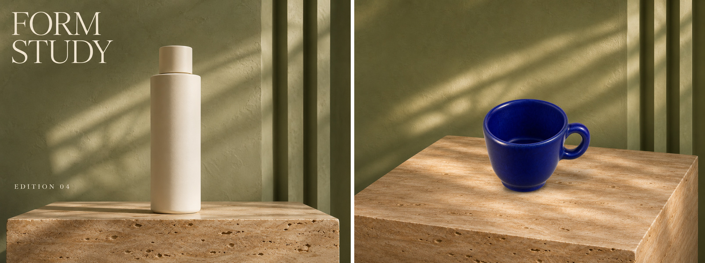

# Product Scene Match

Place an existing product photograph into a reference scene while keeping the product at its original pixel size and camera angle. The skill removes the old product and lettering from the reference, rebuilds the background around the new camera position, then composites the original product pixels.



[Full-resolution result](examples/studio-cup/studio-cup-3840.png) · [Original product](examples/studio-cup/product.png) · [Reference scene](examples/studio-cup/reference.png) · [Clean background](examples/studio-cup/plate.png) · [Geometry report](examples/studio-cup/geometry.json)

## Get the complete project

```sh
git clone https://github.com/demonlee0727-glitch/product-scene-match.git
cd product-scene-match
```

Open this directory in Codex to use the project skill. You can also [download the complete project as a ZIP](https://github.com/demonlee0727-glitch/product-scene-match/archive/refs/heads/main.zip). For another Agent Skills client, load the [product-scene-match directory](.agents/skills/product-scene-match/).

## Use the skill

Attach a reference scene and your product photograph. For the cleanest edges, supply the product as a full-resolution transparent PNG. An ordinary product photo can also be used with an aligned grayscale mask. The host needs image viewing and background editing capabilities. The final compositing step runs locally with Python 3.9+ and Pillow 9.1+.

> Use $product-scene-match. Image A is the reference scene. Image B is my product. Remove the bottle and all lettering from A, keeping the stone plinth, wall and window light. Match the scene to the elevated camera angle of B. Keep my product at its original size and proportions. Export a PNG in the reference aspect ratio with a 3840 px long edge.

You can also ask the agent to find a reference using a description or candidate links. Lettering on the reference scene is removed. Labels and branding on your own product travel with its original pixels.

## What stays fixed

- The foreground can move to a new position. Its scale, rotation, perspective, orientation and proportions stay fixed by default. To request a different share of the frame, specify that requirement separately from native pixel size.
- Opaque product pixels are checked against the source. The original alpha controls how edges and openings blend with the scene. Reflective or transparent products with a baked-in background may require a professionally prepared cutout.
- The default output retains the aspect ratio of the prepared scene and has a long edge of at least 3840 px. The example is **3840 × 2880**. Its background was enlarged from **1448 × 1086**. The transparent product source is **1254 × 1254** and was placed at **1:1**. The report records both the native plate and export sizes.

## Reproduce the studio example

The included reference and product were generated for this example. The reference features a bottle, a headline and an edition number. In the clean background, more of the top and right side of the plinth are visible. From the repository root, install Pillow and run the final composite with the supplied plate and contact shadows.

```sh
python3 -m pip install 'Pillow>=9.1'
python3 .agents/skills/product-scene-match/scripts/compose.py \
  --product examples/studio-cup/product.png \
  --plate examples/studio-cup/plate.png \
  --x 1360 --y 960 \
  --shadow 2100 1990 520 100 -10 42 0.27 \
  --shadow 1872 2042 235 74 -5 15 0.48 \
  --shadow 1862 2064 170 43 0 9 0.42 \
  --output cup-rebuilt.png --report cup-geometry.json
```

For a different photograph, prepare the background following the [scene direction guide](.agents/skills/product-scene-match/references/scene-direction.md), then choose coordinates on the final canvas. Use `--mask` for an RGB product photo with a matching grayscale silhouette: white reveals the product and black reveals the background. The script rejects empty masks, cropped placements and existing output filenames.
